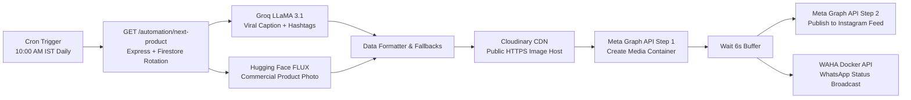

# Califnco Automated Social Media Marketing Engine

This directory contains the production-ready **n8n automation workflow** that automatically posts one featured product per day to **Instagram** with an AI-generated product image and an AI-generated sales caption, along with an optional **WhatsApp Status** broadcast via WAHA.

---

## 1. Architecture Flow



---

## 2. Included Files

| File | Purpose |
|------|---------|
| `automation/workflow.json` | Complete n8n workflow export ready for 1-click import into n8n. |
| `automation/README.md` | Full setup instructions, credential reference, architecture explanation, and interview defense guide. |

---

## 3. How the Daily Catalog Rotation Works

Instead of hardcoding product IDs or requiring complex database queries inside n8n:

1. **State Persistence in Firestore (`automation/state`)**:
   ```json
   {
     "lastPostedProductId": "prod_purifier_04",
     "lastPostedAt": "2026-10-23T04:30:00.000Z",
     "postCount": 4
   }
   ```
2. **Server-Side Rotation (`GET /automation/next-product`)**:
   - Queries all products in the `products` collection sorted deterministically by `id`.
   - Finds the index of `lastPostedProductId`.
   - Selects `(index + 1) % totalCatalog` to pick the next item in line.
   - Atomically advances `lastPostedProductId` and increments `postCount`.
   - Returns the clean product metadata (`name`, `category`, `price`, `description`, `imageUrl`).
3. **Infinite Cycle**:
   - The workflow cycles through all 52 seeded catalog items seamlessly without duplicates, and loops back smoothly to the beginning once completed.

---

## 4. Setup Guide (Step-by-Step)

### Step 1: Install & Launch n8n

You can run n8n locally with Docker or Node.js:

```bash
# Option A: Quick Docker run
docker run -it --rm --name n8n -p 5678:5678 -v ~/.n8n:/home/node/.n8n n8nio/n8n

# Option B: Node.js npm package
npx n8n
```

Open your browser to `http://localhost:5678`.

### Step 2: Import the Workflow

1. In the n8n dashboard, click **Workflows** → **Add Workflow** (or **+**).
2. Click the three dots menu (**⋮**) in the top right corner → **Import from File...**
3. Select `automation/workflow.json` from this repository.
4. The complete 10-node pipeline will appear on the canvas.

### Step 3: Configure Environment Variables / Credentials

In n8n, navigate to **Settings** → **Environments** (or set environment variables in your shell / `.env`):

| Variable | Description | Where to Get |
|----------|-------------|--------------|
| `BACKEND_URL` | Your running backend server URL (e.g. `https://califnco-server.onrender.com` or `http://localhost:3001`) | Your deployed backend |
| `GROQ_API_KEY` | Fast AI inference key for LLaMA 3.1 70B caption generation | Free at [console.groq.com](https://console.groq.com) |
| `HUGGINGFACE_API_KEY` | Access token for FLUX.1-schnell image generation | Free at [huggingface.co/settings/tokens](https://huggingface.co/settings/tokens) |
| `CLOUDINARY_CLOUD_NAME` | Cloudinary account name for hosting generated media | Free at [cloudinary.com](https://cloudinary.com) |
| `CLOUDINARY_UPLOAD_PRESET` | Unsigned upload preset name (default: `califnco_marketing`) | Cloudinary Settings → Upload |
| `META_PAGE_ACCESS_TOKEN` | Long-lived Page Access Token with `instagram_basic` and `instagram_content_publish` scopes | [Meta for Developers](https://developers.facebook.com) |
| `INSTAGRAM_BUSINESS_ACCOUNT_ID` | Your Instagram Professional Account ID | Meta Graph API Explorer |
| `WAHA_URL` | (Bonus) Local WAHA instance URL (default: `http://localhost:3000`) | [waha.devlike.pro](https://waha.devlike.pro) |

---

## 5. Fallback Protection

Social media pipelines frequently fail in production when external AI APIs have rate limits or cold-starts. This workflow implements **fail-safe resilience**:

- **Image Fallback**: If the Hugging Face Inference API experiences queue delay or model loading timeout, node `Format Caption & Fallbacks` automatically falls back to `product.imageUrl` (the high-resolution studio photo from Unsplash seeded in Firestore).
- **Caption Fallback**: If the LLM rate limit is reached, a curated high-converting promotional template is automatically constructed with the real product name, pricing, and hashtags.
- **Upload Resilience**: Cloudinary hosts the final image on a globally distributed CDN with an SSL certificate, guaranteeing that Meta's Instagram crawler can fetch it without TLS errors.

---

## 6. Bonus: WhatsApp Status via WAHA

WAHA (WhatsApp HTTP API) is a headless WhatsApp Web automation tool running as a lightweight Docker container:

```bash
docker run -d --name waha -p 3000:3000 devlikeapro/waha
```

1. Open `http://localhost:3000/dashboard` and scan the QR code with your secondary phone or business number.
2. The n8n workflow sends `POST /api/sendImage` with `chatId: "status@broadcast"`.
3. Every morning, your company WhatsApp Status is automatically updated with the daily featured water purifier, reaching your registered dealer and retail customer contact lists.

---

## 7. Interview Defense Questions & Answers

### Q: Why use n8n instead of a simple Node.js cron script?
> **Answer**: A standalone cron script lacks visibility. When an Instagram token expires or Hugging Face returns a 503 error, a cron script fails silently in a background terminal. n8n provides visual execution tracking, per-step payload inspection, automatic retries with exponential backoff, and a clear audit trail of every published post.

### Q: Why is Cloudinary required if we already have an image?
> **Answer**: Meta's Instagram Content Publishing API does not accept local file uploads or raw base64 data payloads. It strictly requires a public HTTPS URL accessible from Meta's California crawler IP addresses. Uploading to Cloudinary guarantees a publicly resolvable, fast HTTPS URL with proper image dimensions (1:1 square or 4:5 portrait).

### Q: How do you prevent the script from posting the same product twice?
> **Answer**: State is maintained in Firestore under `automation/state` with fields `lastPostedProductId` and `postCount`. Before each post, the server reads the current pointer, finds the product's index in the catalog, selects `(index + 1) % totalCatalog`, and atomically updates the state doc. Even if the server restarts or redeploys, state is never lost.
