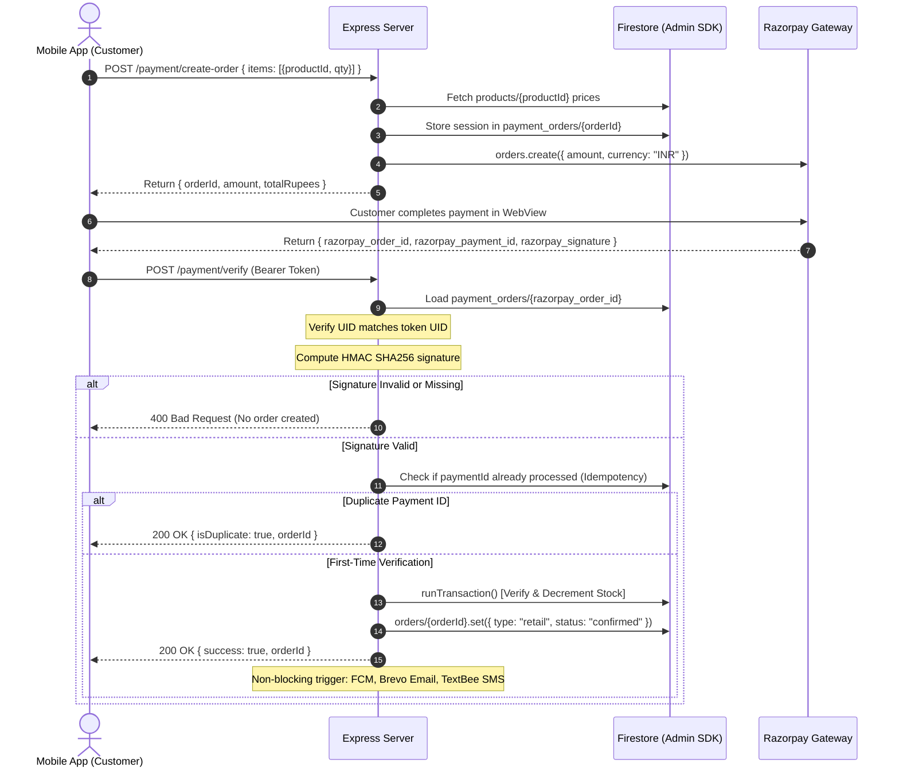

# Explained — Architecture & Technical Defense Guide

I wrote this document in plain first-person language to explain every architectural decision, data flow, and code path across the entire Califnco platform during technical reviews.

---

## 1. Module: Mobile App (React Native & Expo SDK 51)

### What I built
I built the mobile frontend using React Native 0.74 on Expo SDK 51. The app serves two primary personas: retail customers and verified wholesale dealers.
- **Retail Catalog**: Displays all domestic water purifiers, alkaline systems, and spare cartridges with categorized navigation and client-side reactive filtering.
- **Product Detail**: Features zoomable product imagery (pinch-to-zoom and double-tap zoom via native `ScrollView` with zero external native modules), technical specifications, live stock indicators, quantity selectors, and animated Add-to-Cart interactions.
- **Checkout & Razorpay Payment**: Secure in-app payment flow via a clean WebView modal that interacts with the server, handles cancellations, network delays, and payment failures without creating orphan orders.
- **Order Tracking & Receipt Generator**: Live order history with clear `RETAIL` vs `BULK` type labels, real-time status chips, and an in-app printable receipt/invoice modal.
- **Service Desk**: Dual-tab booking interface for scheduling home service, filter maintenance, and water quality testing visits.
- **Dealer Flow**: Automatic routing that presents a pending hold screen for unverified dealers and unlocks the wholesale pricing portal once approved by an administrator.

### How data flows
1. **Authentication**: `AuthProvider` listens to Firebase Auth's `onAuthStateChanged`. Once authenticated, it reads `users/{uid}` in Firestore to resolve the user's role and `dealerStatus`. `AppNavigator` immediately routes the user to `CustomerTabs`, `DealerTabs`, or `PendingApprovalScreen`.
2. **Catalog Fetching**: `CatalogScreen` reads the `products` collection from Firestore. Category filtering and search query indexing occur reactively via `useMemo`.
3. **Cart & Checkout**:
   - `CartContext` maintains local state in memory.
   - On checkout, the app calls `POST /payment/create-order` on the Express backend. The server recalculates pricing from source documents, persists a server-side record in `payment_orders`, and returns a Razorpay Order ID.
   - The app opens a WebView modal loading Razorpay checkout.
   - When the user completes payment, Razorpay returns `razorpay_order_id`, `razorpay_payment_id`, and `razorpay_signature`.
   - The app forwards these credentials to `POST /payment/verify`. Once verified, the server creates the order in Firestore via Admin SDK and returns the order reference.
   - If the user cancels or dismisses the modal, no verification is called, no order is created, and an explicit cancellation alert is displayed.

### Files that matter
- `mobile/src/navigation/AppNavigator.js`: Role-based routing and navigation hierarchy.
- `mobile/src/hooks/useTheme.js`: Dynamic light/dark theme provider responding to system preferences and manual overrides.
- `mobile/src/screens/customer/ProductDetailScreen.js`: Product view with native pinch/double-tap zoom and animated feedback.
- `mobile/src/screens/customer/CheckoutScreen.js`: Address validation, 45s wake-up timeout handling, and Razorpay WebView lifecycle.
- `mobile/src/screens/dealer/DealerCatalogScreen.js`: B2B wholesale ordering portal with minimum order quantities.
- `mobile/src/services/notificationHelper.js`: Non-blocking push notification registration updating `users/{uid}.fcmToken`.

### Review Questions & Answers
**Q1: How did you implement pinch and double-tap zoom without breaking Expo preview APK builds?**  
*Answer:* I used React Native's built-in `ScrollView` with `maximumZoomScale={4}`, `minimumZoomScale={1}`, and `centerContent={true}`, paired with a double-tap gesture handler that calls `scrollResponderZoomTo`. This avoids third-party native libraries like `react-native-gesture-handler` reanimated native modules that frequently fail to link in standalone Expo preview APKs.

**Q2: What happens if a customer attempts to place an order while the Render backend server is cold-starting?**  
*Answer:* Render's free tier spins down idle instances. In `CheckoutScreen.js`, I added an explicit `AbortController` with a 45-second timeout and an informative status banner ("Connecting to server (waking up cloud instance if idle)..."). If the request times out, it aborts cleanly and advises the user to retry in a few moments without corrupting the cart state.

**Q3: How do you prevent clients from tampering with product prices during checkout?**  
*Answer:* The client never sends item prices to the server. The client only sends `productId` and `qty`. The backend looks up each product in Firestore, fetches the actual price, calculates the grand total, and creates the order session server-side.

---

## 2. Module: Server (Node.js & Express Backend)

### What I built
The backend server (`server/index.js`) serves as the trusted authority for payments, dealer wholesale transactions, address lookups, catalog rotation, and multi-channel notifications.
- **Security & Production Guards**: In production (`NODE_ENV=production`), the server verifies that Razorpay keys and Firebase credentials are fully configured and not placeholders; if missing, it refuses to start.
- **Rate Limiting & CORS**: Implements `express-rate-limit` on `/payment/*`, `/orders/*`, `/address/search`, and `/notifications/send`. CORS is strictly restricted to the Vercel admin domain and mobile clients via `ALLOWED_ORIGINS`.
- **Payment Lifecycle**: Provides `POST /payment/create-order` and `POST /payment/verify`. Recomputes order totals server-side, stores session state in `payment_orders`, verifies HMAC SHA256 signatures, enforces idempotency, and performs atomic inventory decrements inside Firestore transactions.
- **Dealer Bulk Ordering**: Implements `POST /orders/bulk`, verifying that the requesting user possesses `role === "Dealer"` and `dealerStatus === "approved"`, enforces wholesale minimum order quantities, and creates B2B orders.
- **Address Geocoding Proxy**: Implements `GET /address/search`, proxying queries to OpenStreetMap Nominatim with a compliant `User-Agent` header to prevent CORS issues on web and mobile.
- **Social Automation Rotation**: Implements `GET /automation/next-product`, atomically cycling through the catalog in Firestore under `automation/state` to provide daily marketing automation inputs.

### Data flow: Payment Verification & Idempotency

### Files that matter
- `server/index.js`: Primary server entry point, rate limiting, CORS, payment verification, and route definitions.
- `server/firebaseAdmin.js`: Firebase Admin SDK initialization supporting multiple credential formats (Base64 env, file path, secret files).
- `server/services/notificationService.js`: Multi-channel notification dispatch (Brevo REST API v3, TextBee Android Gateway, FCM).
- `server/scripts/testServerSecurityAndIdempotency.js`: Automated test suite for authentication, idempotency, transaction rollbacks, and failed payment isolation.
- `server/scripts/verifyPhase3.js`: Integration test suite validating end-to-end payment verification and dealer bulk flows.

### Review Questions & Answers
**Q1: What happens if a network glitch causes the mobile app to call `/payment/verify` twice for the same payment?**  
*Answer:* The verify endpoint is strictly idempotent. Before processing, it queries `orders` where `paymentId == razorpay_payment_id`. If an order already exists, it immediately returns `200 OK` with `{ isDuplicate: true, orderId: existingOrder.id }` and skips the inventory decrement transaction, ensuring stock is never double-deducted.

**Q2: How does the server handle inventory depletion during concurrent checkouts?**  
*Answer:* Stock decrement is wrapped inside a Firestore transaction (`db.runTransaction`). The server reads the current stock of all items in the order, verifies `currentStock >= requestedQty`, and decrements atomically. If any item is out of stock, the transaction aborts, throws a 500 error, and writes nothing to the database.

**Q3: What happens if Brevo email or TextBee SMS fails during checkout? Does the order fail?**  
*Answer:* No. Multi-channel notifications are dispatched inside a separate try-catch block using unawaited `.catch()` promises after the database transaction commits. Notification failures are logged as warnings and never interrupt or fail the customer's checkout response.

---

## 3. Module: Admin Web (React 18 & Vite)

### What I built
I created an administrative web dashboard for Califnco executives to monitor orders, manage dealer applications, track field service requests, and review inventory.
- **Executive Authentication & Role Gate**: Verifies that the signed-in user document contains `role === "Admin"`. Any authenticated non-admin user is immediately signed out and shown an "Access Denied" barrier.
- **Fulfillment Operations**: Real-time order monitor with one-click filtering between `ALL`, `RETAIL`, and `BULK` orders, full search across order IDs, customer UIDs, and line items, and instant order status transitions (`confirmed` -> `shipped` -> `delivered`).
- **Dealer Verification Pipeline**: Lists dealer onboarding applications with contact details, business credentials, and dedicated `Approve` and `Reject` buttons that update `users/{uid}.dealerStatus`.
- **Service Desk**: Live feed of customer technician requests with status controls (`pending`, `in-progress`, `resolved`) and an internal technician notes modal.
- **Clean Production Bundle**: Built with Vite 5. No credentials, tokens, or prefilled test accounts exist in the client code bundle.

### Files that matter
- `admin-web/src/App.jsx`: State management, real-time Firestore listeners, and view routing.
- `admin-web/src/views/LoginView.jsx`: Admin login view with explicit Firestore role verification.
- `admin-web/src/views/OrdersView.jsx`: Retail vs. Bulk order filter and status update dispatch.
- `admin-web/src/views/DealersView.jsx`: Dealer application review and status toggles.
- `admin-web/src/views/ServicesView.jsx`: Service ticket management and technician notes.

### Review Questions & Answers
**Q1: How is the admin web app protected against unauthorized access?**  
*Answer:* Protection is enforced at both the UI and database levels:
1. `LoginView.jsx` and `App.jsx` fetch `users/{uid}` upon login; if `role !== "Admin"`, the app signs out the user immediately.
2. Firestore security rules enforce `isAdmin()` on all write operations to products, wholesale, orders, and user roles. Even if a user bypassed the frontend, direct Firestore REST or client SDK calls are rejected by Google Cloud servers.

**Q2: How are order status updates propagated to customers?**  
*Answer:* When an administrator changes an order's status from the dashboard, `App.jsx` updates `orders/{orderId}.status`. The server-side status route triggers multi-channel notifications (email, SMS, and FCM push) to the customer associated with that order.

---

## 4. Module: Automation Engine (Social Media Marketing)

### What I built
The automation system publishes one featured product per day to Instagram with an AI-synthesized product image, a strictly factual caption, and an optional WhatsApp Status broadcast via WAHA.
- **Catalog Rotation**: Calls `GET /automation/next-product` with 60-second timeouts and 3 retries, cycling through products sequentially via Firestore state (`automation/state`).
- **Factual Copywriting via Groq**: Queries Groq API using `llama-3.3-70b-versatile` (with dynamic runtime fallback selection from Groq's active model list). Strictly forbids invented discounts, "festive offers", percentage claims, installation promises, or medical claims. Strips all markdown (`**`, `#`, backticks), producing 2 to 4 clean lines, 1 call-to-action mentioning the Califnco app, and 5 to 8 hashtags under 2,000 characters.
- **Studio Product Imagery**: Attempts Hugging Face `FLUX.1-schnell` router first when API keys are configured, falling back automatically to Pollinations FLUX. Generates high-resolution (1080x1080) clean studio product photography on a neutral background. Validates that output bytes are a valid JPEG or PNG larger than 10 KB. Never substitutes catalog photos.
- **Cloudinary CDN Upload**: Uploads using signed credentials to folder `califnco/daily-posts`, public ID `<productId>-<YYYYMMDD>`, overwrite true. Derives an Instagram-optimized 1:1 square URL (`/upload/f_jpg,c_fill,ar_1:1,w_1080,q_auto/`) and confirms via a `HEAD` request that it returns HTTP 200 and `image/jpeg`.
- **Meta Instagram Publishing**: When `META_ACCESS_TOKEN` and `IG_USER_ID` are configured, creates a container via `POST /{IG_USER_ID}/media`, polls status until `FINISHED` (60s timeout), publishes via `POST /{IG_USER_ID}/media_publish`, and prints the permalink. If credentials are missing, prints `NOT POSTED: Meta credentials missing (META_ACCESS_TOKEN, IG_USER_ID)` and exits with code 2.
- **WAHA Broadcast**: If `WAHA_URL` is set, dispatches a status update via `POST /api/sendImage` without blocking the pipeline.
- **GitHub Actions Scheduler**: Configured under `.github/workflows/daily-post.yml` to trigger daily at 10:00 AM IST (`cron: '30 4 * * *'`) and on `workflow_dispatch`.

### Files that matter
- `automation/runDailyPost.js`: Complete standalone runner executing all 5 steps with robust validation.
- `.github/workflows/daily-post.yml`: GitHub Actions serverless cron schedule and secrets mapping.
- `automation/workflow.json`: Exportable n8n workflow representing the visual alternative architecture.
- `automation/README.md`: Setup instructions, GitHub Secrets documentation, and operational reference.

### Review Questions & Answers
**Q1: Why did you switch from a local n8n instance to GitHub Actions for the scheduler?**  
*Answer:* Running a local n8n instance requires an always-on physical computer or a paid cloud VM running 24/7. GitHub Actions runs serverlessly on GitHub's cloud runners at 10:00 AM IST daily for under 1 minute, consuming zero local resources and zero hosting cost within GitHub's free monthly allowance.

**Q2: What happens if Groq deprecates or changes their model catalog?**  
*Answer:* In `automation/runDailyPost.js`, the script queries `GET https://api.groq.com/openai/v1/models` at runtime before issuing completions. It tests for `llama-3.3-70b-versatile` and selects an active verified fallback (e.g., `openai/gpt-oss-120b`) if unavailable, logging the exact model used.

**Q3: Why is Cloudinary necessary in the Instagram posting pipeline?**  
*Answer:* Meta's Instagram Graph API does not accept direct image uploads or raw binary payloads. It strictly requires a public, SSL-secured HTTPS URL that Meta's servers can crawl. Cloudinary delivers the image with optimal dimensions (`1080x1080`), auto-compression (`q_auto`), and JPEG format formatting.

---

## 5. Module: Firestore Security Rules

### What I built
A centralized, battle-tested `firestore.rules` ruleset that enforces role-based access control and client isolation at the database engine level.
- **Client Order Creation Denial (`match /orders/{orderId} { allow create: if false; }`)**: Clients cannot create order documents directly. All orders must be validated and created server-side via the Express backend and Admin SDK after signature verification and stock reservation.
- **Wholesale Isolation (`match /wholesale/{id}` & `match /payment_orders/{id}`)**: Wholesale pricing documents can only be read by approved dealers or admins. `payment_orders` is strictly unreadable and unwritable by any client.
- **User Role Immutability**: Users can update their own non-sensitive profile fields (name, phone, address, FCM push token), but rules strictly reject any attempt to modify `role` or `dealerStatus` (`!("role" in request.resource.data.diff(resource.data).affectedKeys())`).
- **Public vs. Protected Collections**: `products` is publicly readable; `services` can be created by authenticated users with initial status `pending`; `automation` state is inaccessible to clients.

### Review Questions & Answers
**Q1: Why did you forbid clients from creating orders directly in Firestore (`allow create: if false`)?**  
*Answer:* In client-side order creation, a malicious user could inspect network traffic, forge order amounts, fabricate fake payment IDs, bypass inventory counts, or inject custom items. By forbidding client-side order creation, all orders are guaranteed to pass through server-side price recomputation, HMAC SHA256 signature verification, and atomic inventory transactions.

**Q2: How do you verify that your security rules actually work in practice?**  
*Answer:* I wrote a dedicated client-side security test suite (`server/scripts/testRulesSecurity.js`) that signs in as Guests, Customers, Pending Dealers, and Approved Dealers, attempting both authorized and unauthorized operations. The suite asserts that unauthorized operations throw `permission-denied` errors, achieving a 27/27 pass rate.
